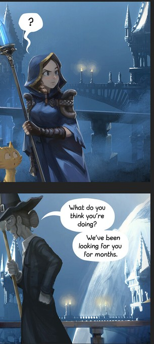

<div align="center">
  <h1>Manga Translator</h1>
  <p><strong>Translate a manga, manhwa or webtoon chapter on your own computer. No GPU, no account.</strong></p>
  <p>
    <a href="https://github.com/tuantran00541-spec/manga-translator/releases/latest">Download</a> ·
    <a href="#install">Install</a> ·
    <a href="docs/FEATURES.md">Features</a> ·
    <a href="docs/INSTALL.md">Install guide</a> ·
    <a href="docs/CONFIGURATION.md">A.I setup</a> ·
    <a href="docs/DEVELOPMENT.md">Development</a>
  </p>
  <p>
    <a href="https://github.com/tuantran00541-spec/manga-translator/actions/workflows/release-gate.yml"></a>
    <a href="https://github.com/tuantran00541-spec/manga-translator/releases/latest"></a>
    <a href="LICENSE"></a>
  </p>
</div>

<p align="center">
  
  
  
</p>
<p align="center"><sub>Raw → cleaned → translated to Vietnamese, all by this app. From <a href="https://www.peppercarrot.com/en/webcomic/ep38_The-Healer.html">Pepper&amp;Carrot ep. 38</a> by David Revoy, <a href="https://creativecommons.org/licenses/by/4.0/">CC BY 4.0</a>.</sub></p>

Give it a chapter link, a ZIP/CBZ or a folder of images. It erases the original lettering, translates it and letters the translation back, and every step stays editable before you export.

| Clean | Translate | Edit |
| :--- | :--- | :--- |
| Erases letters, outlines and glow, keeps the art | **A.I mode** runs a whole chapter for about $0.07 | Undo/redo, brush, restore, find & replace |
| Two full webtoon chapters: **0** text left | Vietnamese, English, Indonesian, Spanish, Portuguese, French, German | 71 comic fonts, style presets, keyboard proofreading |
| Small ONNX models, runs on any laptop CPU | Any OpenAI-compatible provider, or your own key | Exports the stitched chapter as a ZIP |

[All features, benchmarks and limitations →](docs/FEATURES.md)

## Install

**Windows:** download [MangaTranslator-Setup.exe](https://github.com/tuantran00541-spec/manga-translator/releases/latest/download/MangaTranslator-Setup.exe) and double-click it. If SmartScreen says "Windows protected your PC", click **More info → Run anyway** (the setup is not code-signed yet).

**Or one command**, nothing else needed first:

```powershell
# Windows (PowerShell)
powershell -ExecutionPolicy ByPass -c "irm https://raw.githubusercontent.com/tuantran00541-spec/manga-translator/main/install.ps1 | iex"
```

```bash
# Linux / macOS
curl -LsSf https://raw.githubusercontent.com/tuantran00541-spec/manga-translator/main/install.sh | sh
```

The first install takes 5–15 minutes and about 5 GB free. Then open the **Manga Translator** icon (Windows), or type in a new terminal:

```bash
manga           # open the app
manga update    # get the latest version; models, chapters and settings stay
```

Manual install, Docker, the browser extension and uninstalling: [docs/INSTALL.md](docs/INSTALL.md).

## How it works

**By hand:** import a chapter, clean it, then fix, OCR, translate and letter it in the editor.

**A.I mode:** paste a chapter link, pick a language and add an A.I key. It scans, cleans, reviews and translates the chapter, then opens the result in the same editor. Keys and providers: [docs/CONFIGURATION.md](docs/CONFIGURATION.md).

Hand-drawn sound effects, text painted into the art and warped lettering still need a person; [the full list](docs/FEATURES.md#current-limitations).

## License

[AGPL-3.0](LICENSE). Fonts (OFL-1.1), the Vietnamese word list (MIT) and the downloaded models keep their own licenses.
